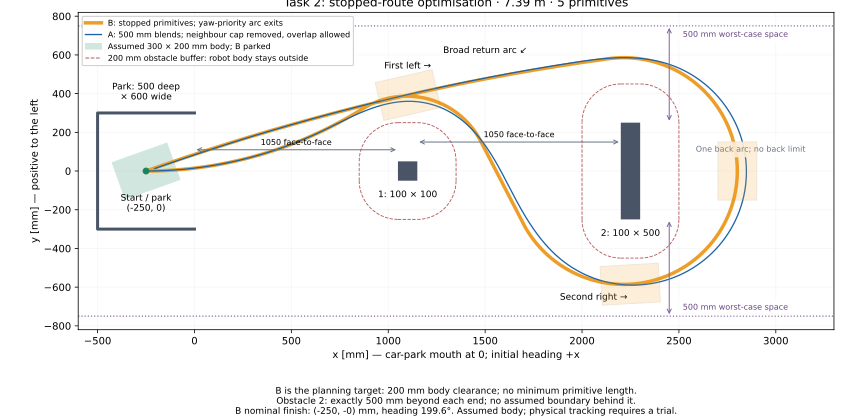

# Experimental fused motion sequence

Branch: `experiment/task2-fused-stopped-comparison`.
Forked from pre-response-planner commit `6d7f13767d18302bd84225aff0fe9a0db66db205`.
The later measured-response planner (`fe9704f`) and its validation harness are
not used. The original experiment branch is preserved.
Base: `90fa9d3b4d37080a7bf035abe1c3439fd2361ffb` on
`experiment/fused-motion-sequence`, with the separate-limits change adapted from
`feature/motion-profile-limits` commit `df2fc280541868bff87ff8813cf36dc48462deb0`.
The separate production UART and IMU-hardening changes are not included.

## Current default: Task 2 fused versus standalone stopped

`TestMain.c` selects `MotionSequenceFusionTestRun()`, with
`MOTION_SEQUENCE_FUSION_TEST_TASK2_TIMING` as the default selector. It uses the
seven primitives described in [Task 2 comparison](#task-2-comparison).
A freezes the last logged pre-response-planner tuning (longblend runs 15/16);
B uses the confirmed Task 1 stopped tuning and standalone yaw-priority arc exits.
Shared production controller and planner defaults are unchanged.

## Optional historical single tuning run

`MotionSequenceFusionTestRun()` runs the longer transition accuracy path once. There
is no P100 baseline, second button prompt, or A/B comparison in this mode.
Select `MOTION_SEQUENCE_FUSION_TEST_SINGLE_TUNING` before entering the harness.

| Regime | Yaw-rate P / I / D | Heading gain (s⁻¹) |
| --- | --- | ---: |
| Straight | 150 / 50 / 0 | 0.5 |
| Arc | 150 / 100 / 0 | 0.5 |

These are the measured run 12–14 settings. This experiment changes the path
and blend length to investigate transition lag/ringing with that tuning fixed;
it does not establish that the tuning is stable.

Edit `motionSequenceFusionTestStraightTuning` and
`motionSequenceFusionTestArcTuning` at the top of `MotionSequenceFusionTest.c`
to choose the next trial's gains. These test-local settings can also be set in
GDB before `MotionSequenceFusionTestRun()`. They are copied to the controller
before validation/PID initialization and the ready screen. Shared production
configuration is unchanged. The OLED reads actual straight/arc gains; the
result stores `straightTuning` and `arcTuning` snapshots.

The matched geometric reference `LPF(curvature * measured speed)` uses the same
100 ms time constant, update dt and zero initial state as the gyro-rate filter.
Nominal raw steering feedforward always uses current curvature.

| Segment | Distance | Radius | Requested speed |
| --- | ---: | ---: | ---: |
| Entry straight | 1000 mm | Straight | 5000 CPS |
| Left semicircle | 1649.34 mm (180°) | +525 mm | 5000 CPS |
| Exit straight | 1000 mm | Straight | 5000 CPS |

Total commanded travel is **3649.34 mm**, displayed before starting. Wheel
Kp=0.03, Ki=Kd=0; straight A/D is 3000/3000 mm/s²; arc/blend A/D is
2000/2000 mm/s². Test-local blend length is **500 mm**, junction ceiling 8000 CPS and
steering slew 480 raw/s. Feedforward, wheel synchronization and correction
limits retain the preceding experiment's settings.

The existing quarter-segment bound is unchanged. Both neighbouring straights
are 1000 mm, so each junction gets its full 500 mm blend (250 mm from each
side). Entry blending covers progress 750–1250 mm; exit blending covers
2399.34–2899.34 mm. At 5000 CPS (~660 mm/s), each nominal blend takes about
0.76 s. Feedback may still demand command changes up to the existing 480 raw/s
slew limit; this experiment does not lower that limit. Production sequence
defaults remain unchanged, including their 200 mm blend.

Mark the rear-axle midpoint at `(0,0)`, heading `+x`. The unblended centreline
reaches `(1000,0)`, then `(1000,1050)` heading `-x`, then `(0,1050)`.
Integrating the actual 500 mm linear-curvature blends gives an endpoint near
**(0,1089.36) mm**, yaw 180°; the extra 39.36 mm in y is nominal geometry, not
tracking error. The blended centreline reaches x≈1523.12 mm. Reserve approximately
**2.0 m along x × 1.6 m along y**, for example x=-200…1800 and y=-200…1400 mm,
allowing an assumed centred 300×200 mm chassis. Leave additional room for
tracking error and actual chassis offsets. The blends preserve total nominal
distance/yaw but change XY.

1. Build/flash and set a breakpoint at `MotionSequenceFusionTestFinished`.
2. Place the robot at the marked start. OLED shows `Tuning ready`, estimated
   travel and actual straight/arc gains. Press/release SW1 once to start.
   SW1 during the run cancels it.
3. After the robot stops, export once with a fresh filename:

```text
source exp/gdb_scripts/export_fused_motion.gdb
set $mctrl_fusion_battery_v = 11.66
mctrl-fusion-export fusion_tuning_run01.txt
```

Enter the actual battery voltage. Control runs every 10 ms; samples are recorded
every 20 ms. This one trial has the full 650-sample budget, about 13 seconds
including preparation/braking. Overflow sets truncation flags, preserves the
final sample and marks the overall test invalid. Manual waiting and the 400 ms
hand-clearance delay are excluded from elapsed time.

The export contains one result and only this trial's samples, all tagged with
`comparisonRunIndex = 0`. The unused second result slot is omitted.
`motionSequenceFusionTestPassed` indicates complete, untruncated execution;
physical accuracy must still be assessed from tracking and endpoint measurements.
`motionSequenceFusionTestComparisonValid` is false and time-savings fields are
zero because this is a single run. The final OLED shows duration and yaw error.

Inspect raw/filtered gyro rates, geometric yaw references, steering-correction
saturation/ringing at the blends, sustained arc yaw-rate bias, and heading error
entering/leaving the final straight. Record physical endpoint displacement
separately; successful execution does not establish Task 2 parking accuracy.
Compare transition and immediate recovery behaviour with runs 12–14, rather
than final yaw alone: the longer straights provide additional settling time.

The host checks cover one start/result, dynamic gains and ready-screen values,
matched references, completion, cancellation, timeout, full log capacity and
retained final samples, plus the original controller/planner regressions.
These are software checks, not physical servo/vehicle results.

Other experiments remain available by changing the selector before the run:

- `MOTION_SEQUENCE_FUSION_TEST_REFERENCE_FILTER`: P100/0/0 and heading zero,
  existing versus matched filtering on the short path.
- `MOTION_SEQUENCE_FUSION_TEST_TASK1_GAINS`: P100/0/0 versus Task 1 P270/I150/D0,
  heading zero and matched filtering on both runs.
- `MOTION_SEQUENCE_FUSION_TEST_TASK2_TIMING`: the current default seven-primitive
  Task 2 course, frozen fused tuning versus established stopped tuning.

The two short A/B modes retain the original 300 mm / R525 semicircle / 600 mm
path and the shared 200 mm blend. They reserve 325 samples per run and require a pose reset
between runs. The remaining course description applies to the optional timing mode.

## Wheel-performance settings

The optional timing A/B harness requests 5000 CPS on a Task 2 outward route / broad-arc-return course
that returns to the car park. Both traces use one experiment-local configuration:

| Motion | Acceleration (mm/s²) | Deceleration (mm/s²) |
| --- | ---: | ---: |
| Straight | 3000 | 3000 |
| Arc / curvature-changing blend | 2000 | 2000 |

Both wheel PID gains are Kp = 0.03, Ki = 0. These are candidates from the wheel
campaign, pending validation with steering, heading and synchronisation active.
Shared controller defaults remain 1500/1000 for both modes and wheel Kp = 0.02.

Constant straight sections use straight limits. Any curvature-changing blend
uses arc limits throughout, including opposite-turn blends as curvature crosses
zero. Gain interpolation remains independent of this limit selection. Joined
straight segments keep straight limits even within their nominal blend interval.
The same selection applies to the stopped comparison's `FollowProfile` runs.

Lookahead integrates deceleration over each section ahead: the squared speed
budget is `2 * integral(deceleration * distance)`. Thus a straight can exploit
its stronger limit while approaching a weaker arc, and final stopping accounts
for later sections instead of extending the current section's limit to the end.
The final yaw-priority approach uses that budget up to its terminal window too.
Existing yaw-priority completion, stationary confirmation and fault handling
are preserved. These are centre-speed limits: curvature changes and feedback
can still add wheel acceleration/deceleration demand; hardware tracking must be
checked. This change does not establish a wheel-acceleration guarantee.

Each sample logs active acceleration/deceleration limits and the planned
stopping-speed ceiling. The one final GDB export includes both traces, their
actual controller configuration and both wheel PID configurations.

## First implementation

`MotionSequence` owns the batch, lookahead, blend/stop policy and completion.
It uses the new `MotionController_FollowProfile()` capability for each continuous
run. The original straight/arc APIs and their tuning/terminal behaviour are
retained. No heap allocation; capacity is 20 nonzero segments (the current Task 2 course needs 7).

Each curvature change gets a symmetric linear curvature ramp. Its full length
is at most `blendLengthMm`; each neighbour supplies at most one quarter of its
own length. Thus blends on both sides of a short segment cannot overlap.
Equal-curvature segments join without a curvature change or an extra speed cap.

The ramp consumes existing distance, adds zero nominal distance, and preserves
the integral of curvature over signed travel. Desired heading is evaluated by
analytic integration, not by multiplying current curvature by total travel.
Intermediate junctions are virtual: their exact position and heading are not
required. The final **nominal** heading and distance are preserved, while the
XY trajectory differs from the original piecewise straight/arc path.

Straight-ending profiles and intermediate stopped runs complete by distance
using the inherited 0.5 mm tolerance. If the batch ends in an arc exceeding the
inherited 0.5-degree minimum, its final run instead retains **yaw-priority arc
termination** for camera heading:

* The final target is the analytically integrated heading of the entire current
  fused run. It includes preceding segments and their blends, so yaw error
  accumulated within that run remains visible to termination.
* The approach speed is limited toward 800 CPS before the terminal window.
  The window begins in the final constant-curvature section, after its incoming
  blend, and at most 30 mm before nominal distance completion.
* The braking decision predicts stopping yaw from the freshest raw gyro rate
  using the inherited 75 ms horizon. Direction comes from final arc curvature
  and travel direction, even when mixed turns give zero or opposite-sign net yaw.
* The controller may brake before nominal distance completion if predicted yaw
  reaches the target, or continue at up to 400 CPS when distance finishes first.
  Creep is also capped by the final segment's requested speed.
* Heading and curvature references freeze at the nominal endpoint during
  overrun. The inherited maximum 30 mm overrun guard still forces braking.

Both termination paths use the existing centred-steering braking and stationary
sample completion. The desired geometric path still preserves nominal distance
and heading area, but final-arc actual distance may now differ to prioritise
camera orientation. Actual tracking and the empirical stopping-yaw prediction
still require hardware validation. No final XY-pose guarantee is provided.

`terminalYawPredictedReached` and `terminalDistanceLimitReached` distinguish
heading-triggered braking from the distance guard; reaching the guard alone does
not demonstrate successful camera heading. Final measured yaw includes braking
and may differ from predicted yaw. Completed-run errors across earlier stops
remain diagnostic and are not carried into the final run's heading reference.

Direction changes and `stopAfter=true` split the batch into rest-to-rest runs.
The next run starts only after braking reports stationary for the configured
sample count, then performs its initial steering preparation. Zero-distance
commands are no-ops; a zero-distance stop marks the preceding segment.

Within a run, odometry, yaw, measured-speed/yaw-rate filters, synchronisation
history and yaw-rate PI state continue across junctions. Gain weights interpolate
between the straight and arc endpoint regimes over each blend. Integral state
is rescaled to preserve its output contribution when Ki changes; Ki=0 clears
that contribution. Opposite-sign arc blends use arc gains throughout. The
profile's raw steering slew limiter remains in effect. A per-run rate override
is copied from the sequence configuration; zero inherits the normal steering
calibration rate. Standalone motions always retain their normal rate, including
when issued after a fused run on the same controller.

## Experimental feedforward bridge and junction speed

The calibrated arc branches stop short of zero curvature. Profiles alone use a
linear bridge from the configured straight raw feedforward to the nearest
point in each branch. This is an **unvalidated near-centre model**, needed for a
continuous straight/arc or opposite-sign blend. Standalone `MoveArc` still
rejects the uncalibrated near-zero gap. The outer calibrated limits are never
extrapolated. Existing servo clamping and the base's limited-headroom arc
experiment remain; feedback may run out of headroom at extreme commands.

Defaults in `Controllers/Src/MotionSequencePlan.c`:

| Setting | Value |
| --- | ---: |
| Maximum full blend length | 200 mm |
| Curvature-changing junction speed ceiling | 8000 CPS |
| Fused-profile raw steering slew limit | 480 raw units/s |
| Feedforward allocation of configured raw slew rate | 50% |

These retain the latest fusion branch settings. The 8000 CPS ceiling is
still bounded by each segment's requested speed and the steering slew budget. The sequence's slew override is used by both the planner and the
steering executor; it does not modify `steeringCalibration` (120 raw units/s).
Set `steeringCommandRatePerSec=0` to inherit that rate. For the original slow
profile use `{.blendLengthMm=200, .junctionSpeedCps=500,
.steeringCommandRatePerSec=0}`. Overrides must be finite and nonnegative.

The planner also limits junction speed using the largest slope of the complete
piecewise-linear feedforward map (including the centre bridge), curvature ramp
length, and effective per-sequence raw slew rate. The remaining slew allowance is reserved
for feedback; it is not a guaranteed physical servo margin. Speed lookahead
uses the integrated straight/arc deceleration to approach each lower
segment/junction speed before its boundary. `MotionProfile` supplies the active
section's acceleration and consumes the planner's final stopping envelope.
These are configurable software protections, not a measured servo speed limit.

## API example

Keep the sequence object and its controller alive until execution finishes.
Check every returned status in application code. Configuration, calibration and
the sequence plan must remain unchanged while running. Do not reuse a running
sequence object or issue separate commands to its controller.

```c
static MotionSequence sequence;

MotionSequence_Begin(&sequence, &robot.motionController, &motionSequenceConfig);
MotionSequence_AddStraight(&sequence, 300.0f, 2000.0f, false);
MotionSequence_AddArc(&sequence, 500.0f, -500.0f, 2000.0f, false);
MotionSequence_AddStraight(&sequence, 300.0f, 2000.0f, false);
MotionSequence_Execute(&sequence); /* asynchronous */

/* At each control period: */
MotionSequence_Update(&sequence, dt);
```

Call only `MotionSequence_Update`, not also `MotionController_Update`.
`MotionSequence_Brake` cancels the remaining batch and enters braking; continue
updates until `MotionSequence_IsBusy` is false. IMU/profile errors retain the
base controller's immediate Stop/coast error semantics and mark the sequence
failed; remaining runs are not launched. `completedMeasuredTravelMm` and
`completedMeasuredYawRad` accumulate completed runs including braking drift.
They are separate from `plan.totalTravelMm` and `plan.nominalFinalYawRad`.

## Software-only checks

Run with Python 3 and GCC on Linux/WSL:

```sh
python3 Tests/Host/test_unified_motion.py
python3 Tests/Host/test_fused_motion.py
python3 Tests/Host/test_motion_profile_limits.py
# Optional: exporter check using installed host GDB
python3 Tests/Host/test_fused_export.py --gdb /path/to/gdb
```

The fusion test compiles production planner/controller/steering/PID/profile
sources and the actual robot test harness against hardware stubs. It uses
`-Wall -Wextra -Werror -pedantic` and address/undefined-behaviour sanitizers.
Leak tracing is disabled for managed-container compatibility; tested components
perform no heap allocation.

Coverage includes analytic and independently integrated curvature area, total
distance, 150 deterministic generated plans, asymmetric/short segments,
forward/reverse signs, both arc signs, opposite-sign ramps, speed lookahead,
software slew bounds, gain/integral continuity, one preparation per continuous
run, reversals/stop waypoints, capacity/invalid inputs, cancellation, faults,
and the selected hardware harness's completion/cancellation/timeout/final log.
Final-arc cases cover early predicted-yaw braking, continued motion after nominal
arc distance, frozen references on overrun, bounded distance-guard braking,
forward/reverse travel with both turn signs, zero/opposite-sign net targets,
short final arcs, low requested speeds and final-only policy selection.
The faster-profile checks also verify that both original straight/arc test junctions retain
2000 CPS, the executor uses the 480 raw units/s override, a subsequent standalone
motion returns to 120 raw units/s, zero inherits that limit in planner/executor,
and invalid rate overrides are rejected before motion.

The original 300 mm / R=-500 mm arc / 300 mm experiment completed in 4885 ms
in the ideal encoder/gyro harness, versus 8526 ms with the previous defaults
(about 43% less time). The current harness uses the longer A/B course below.
This measures software speed/preparation/braking scheduling with synthetic
perfect speed tracking, not physical servo response or robot accuracy.

The real GDB exporter also passed checks against initialized host ELF data:
plan/config/result fields, all samples, empty/invalid-count guards and the
complete marker. It did not require a running process or a probe.

The standalone suite sets explicit preparation times and a heading gain for
its heading-bound checks, so those checks do not depend on experiment defaults.
The separate-limits checks cover all four limits, forward/reverse mode changes,
completion-tolerance preservation, invalid inputs and arc terminal approach.
Fusion checks additionally cover local limit changes, independent integration
of the stopping envelope, stronger straight approach to a weaker arc, stopped
mode selection, opposite-turn zero crossing and the experiment's actual gains.

The full ARM Debug firmware builds and links with the configured source
exclusions and the unchanged STM32 FLASH linker script. Changed firmware sources
also pass `-Wall -Wextra -Werror`. The final image uses approximately 104 KiB FLASH
code/constants and approximately 119 KiB RAM (including the shared sample buffer, heap and stack
reservations), within the STM32F407's configured memory. Control-period timing
and physical robot trials still require hardware validation.

## Task 2 comparison

Build/flash this branch normally after refreshing and cleaning the CubeIDE
project. This is a fixed-route physical trial representing Task 2, with first
arrow left and second arrow right. It does not yet implement arrow recognition,
obstacle measurement, or vision/IR approach stops.



### Layout, body clearance and route optimisation

B is the planning target. The former requirement that every primitive exceed
1 m has been removed; the route is no longer shaped around A's blend lengths.
Coordinates are millimetres, x along the initial forward direction, positive y
left. Both face-to-face gaps remain 1050 mm.

| Item | Placement / dimension |
| --- | --- |
| Park interior | x=-500…0, y=-300…300; mouth at x=0 |
| Initial rear-axle midpoint | (-250, 0), heading +x |
| Obstacle 1 | centre (1100, 0), 100 × 100 |
| Obstacle 2 | centre (2250, 0), 100 along x × 500 along y |
| Worst-case side boundaries | y=-750…750: exactly 500 mm beyond obstacle 2's ends |
| Space behind obstacle 2 | No stated limit; no far x boundary is imposed |
| Assumed body | Centred 300 × 200 mm rectangle |
| Required body-to-obstacle clearance | 200 mm, measured from the outer body |

The graph marks the **200 mm obstacle buffer**, which the entire body must stay
outside, and the **500 mm worst-case end gaps**. The body dimensions and its
position relative to the rear axle are assumptions, pending a measured chassis
footprint. There is no obstacle-2 back-clearance constraint.

`Tests/Host/plan_task2_route.py` uses SciPy SLSQP from three seeds to minimise
nominal forward travel within a seven-primitive tangent-circle family, with
radius at least 275 mm. It checks exact rectangle separation and side/park
bounds. This is the shortest densely verified candidate found within that
family; **global optimality is not proven**. `Tests/task2_route_plan.json` records
the solver outcome, parameters and generated distances/radii.

The unchanged standalone yaw predictor stops arcs about 7–8 mm early in the
ideal fixture. A nominally 201.9 mm-clear route therefore executed with only
189.6 mm clearance. The final search includes a **20 mm terminal-exit reserve**
and 2 mm sampling/numeric reserve: planned body separation is 222 mm. The host
then independently verifies the actual stopped execution, rather than relying
only on the nominal centre path. No termination tuning is changed.

| Primitive | Distance (mm) | Radius (mm) | Heading change |
| ---: | ---: | ---: | ---: |
| 1: Broad departure left | 1167.02 | +2102.56 | +31.80° |
| 2: Right sweep around obstacle 1 | 670.93 | -452.29 | -84.99° |
| 3: Diagonal crossover | 796.40 | straight | 0° |
| 4: Lower turn around obstacle 2 | 996.45 | +392.61 | +145.42° |
| 5: Pass behind obstacle 2 | 436.78 | straight | 0° |
| 6: Upper turn onto return | 562.48 | +342.93 | +93.98° |
| 7: Broad return arc into park | 2568.09 | +10718.59 | +13.73° |

Total nominal travel is **7198.15 mm**, 611.33 mm (**7.8%**) shorter than the
former 7809.48 mm route. The shortest primitive is 436.78 mm. All travel remains
forward. One broad right arc carries the departure heading around obstacle 1;
the final broad left arc returns directly into the park. Final nominal heading
is **199.93°**, 19.93° oblique to the inward axis.

At at most 1 mm spacing, production-planner geometry checks both obstacle
passes in each direction, exact body-to-obstacle distance, side boundaries,
park walls and body intersections with the mouth. Nominal B minimum obstacle
clearance is **221.91 mm**, side-boundary margin **34.77 mm**. It ends at
**(-250, 0)**. Nominal A clearance is **202.18 mm**, side margin **37.73 mm**,
endpoint approximately **(-225.19, +15.50)**. Both nominal bodies fit in the park.
A remains secondary; its requested 500 mm blends are shortened by the existing
quarter-segment bound. There is no full-blend requirement on this route.

The ideal encoder/gyro execution of B is tracked at every 1 ms fixture tick,
including steering preparation, standalone arc termination and braking. Its
minimum body clearance is **210.59 mm**, side margin **35.04 mm**, and final pose
**(-253.07, +80.27)** at **198.33°**. The whole body fits in the park and crosses
the mouth without touching a wall. This is a software fixture with ideal wheel
speed and curvature response; it does not establish physical tracking accuracy.

### Frozen operating points and termination

| Setting | A: frozen fused | B: standalone stopped |
| --- | --- | --- |
| Straight P / I / D; heading gain | 100 / 50 / 0; 0.5 s⁻¹ | 270 / 150 / 0; 0 |
| Arc P / I / D; heading gain | 150 / 75 / 0; 0.5 s⁻¹ | 270 / 150 / 0; 0 |
| Geometric yaw-rate reference | matched LPF(curvature × measured speed) | curvature × filtered speed |
| Gyro/speed filter time constant | 100 ms | 100 ms |
| Execution | one continuous profile | seven standalone primitives |
| Intermediate arc completion | continuous junctions | yaw-priority exit at every arc |
| Steering rate | 480 raw units/s profile override | normal 120 raw units/s |
| Requested blend length | 500 mm | no blends |

A's tuning is pinned in `MotionSequenceFusionTest_RunPattern()`, independently
of the optional historical single-run tuning variables. B's confirmed production
operating point comes from the Task 1 campaign; its heading outer loop is off.
This compares two complete strategies, rather than isolating one gain or filter.

Both request **5000 CPS** on every primitive, wheel P=0.03/I=D=0, correction
limit 30 raw units, synchronisation Kp=10 and limit 100 CPS, straight A/D
3000/3000 mm/s² and arc A/D 2000/2000 mm/s². The negative calibration and existing positive operating points are retained.
The test-local positive table also restores the measured entries used in runs
10-16: (0.000054/mm, -5.625 raw), (0.000183/mm, -11.25 raw), and
(0.000436/mm, -16.875 raw). They were absent from the committed defaults.
These points affect the planner's slope-based junction caps and A's transitions;
the original finite-curvature points used by B are unchanged. The shared
production table is not modified.
A's junction ceiling remains 8000 CPS, bounded by the 5000 CPS requests and
feedforward slew budget. The prepared plan/export records all six actual blend
lengths and junction caps. The shorter primitives deliberately shorten blends;
route optimisation for B takes priority over A's transition geometry.
B keeps the same speed and motion limits for this comparison,
rather than the older production candidate's single 2500/1000 limit pair.

B calls `MotionController_MoveStraight`/`MoveArc` and `MotionController_Update`
directly. It does **not** execute stopped profiles through `MotionSequence`:
that old comparison used distance completion for intermediate arcs. Sequence
storage on B merely holds the route, progress and aggregate measurements for
the shared test logger. Normal centring/steering preparation, PID/filter reset,
terminal approach, stopping-yaw prediction, 30 mm overrun guard and stationary
completion remain the established standalone behavior.

`motionSequenceFusionTestArcExits` records each B arc's zero-based segment index,
nominal/measured travel and relative yaw, plus `yawPredictedReached` and
`distanceLimitReached`, after braking and before the next command resets them.
A distance guard alone means the desired exit heading was not reached according
to the predictor; inspect final measured heading even for yaw-triggered exits.
`usesStandalonePrimitives` and `yawPriorityArcExits` identify the policy in each
run result. A/B do not share measured error corrections between manual runs.

### Running and exporting the comparison

1. Mark the layout, park centre and initial heading. Keep the robot stationary
   through IMU initialization. Set a breakpoint at `MotionSequenceFusionTestFinished`.
2. At `A fused pattern ready`, place the rear-axle midpoint at (-250, 0), facing
   +x. The OLED shows actual gains. Press/release SW1 to run A.
3. A stops and displays `B stopped pattern ready`. Record physical parking,
   then reset to the identical marked start and heading. Press/release SW1 for B.
4. After B stops, record physical parking and export once at the breakpoint:

```text
source exp/gdb_scripts/export_fused_motion.gdb
set $mctrl_fusion_battery_v = 11.43
mctrl-fusion-export task2_compare_run01.txt
```

Enter the measured battery voltage and choose a fresh filename; export appends
if it already exists. The export includes both actual operating points, elapsed
times, nominal/measured travel and yaw, policy flags, A's prepared blend lengths/junction speed caps, the route
description and frozen feedforward table, all recorded stopped arc exits and both runs' tagged samples. It does not resume
the target or initiate motion.

SW1 during either trace cancels and brakes. Each trace has a 60 s watchdog and
3 s additional braking timeout. A failure prevents B from launching; an
incomplete trace withholds savings. Each timer includes preparation, all
intermediate stops on B and final braking; manual waits and the 400 ms
hand-clearance delays are excluded.

The final OLED shows both times, milliseconds saved (`B-A`) and percentage
reduction (`100*(B-A)/B`). Negative savings are retained. `Passed`/`DONE` means
API completion, not physical Task 2 success. Judge the route by correct obstacle
sides, absence of contact, whole-body parking, final heading and time. Record
physical final x/y separately: wheel travel and gyro yaw are not absolute pose.
This fixed route also does not establish successful arrow/image detection.

One shared 650-sample log uses 100 ms sampling; `comparisonRunIndex` identifies
A/B and timestamps restart for B. Manual waits are not logged. Overflow flags
truncation and retains the last sample; summary results and arc-exit records
remain available. The longer sampling period accommodates the full A/B course;
it offers less detail of ringing than the earlier 20 ms short tuning exports.

The ideal encoder/gyro host harness reports **A=16556 ms, B=14774 ms**;
B completes **1782 ms earlier** (12.1% of B's duration). These are software
scheduling times with ideal signals, not physical time predictions. The test
also verifies cancellation/timeout in either run, standalone modes on B,
yaw-triggered exits, distance-guard diagnostics with moving encoders but a
stationary gyro, manual-wait exclusion and per-trace logs. A will eventually be
removed; it remains available for this comparison and is not the planning target.

To rerun the numerical search and regenerate the on-target table and plan record
(requires numpy/scipy), then verify it before using the route:

```sh
python3 Tests/Host/plan_task2_route.py --output Tests/task2_route_plan.json --write-route
python3 Tests/Host/test_fused_motion.py
```

To regenerate the diagram from production planner samples:

```sh
python3 Tests/Host/plot_task2_route.py
```

Controller/planner host regressions, the real GDB exporter, and the full STM32
ARM Debug compile/link pass. Opposite-sign arc transitions on this new course
still require physical validation with the frozen tuning.
