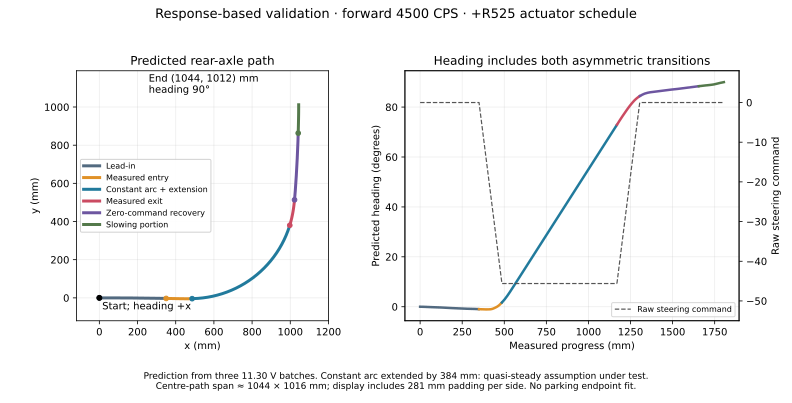

# Response-based fusion endpoint validation

`TestMain.c` selects `MotionResponseTestRun()`. This is a separate opt-in path
planner, not a change to the ordinary straight/arc primitives or their tuning.
It plans the measured body response while retaining the steering and rear-wheel
commands that produced that response. There is one run per export.

## First run

Forward **4500 CPS**, positive-turn **R525 actuator setting**, nominal raw ramp
**200 units/s**, final predicted heading **90°**. The constant arc grows by
**383.87 mm**, from 300 mm to 683.87 mm. The measured lead, entry, exit, recovery
and slowing lengths stay unchanged. Total requested travel is **1804.63 mm**;
predicted endpoint is **(1044.00, 1011.80) mm**, relative to the initial rear-axle
centre, with initial heading along +x. The displayed estimated area is about
**1606 × 1578 mm**, including 281 mm padding on every side. It is a planned
footprint, not a bound on tracking error.



| Portion | End progress (mm) | Steering schedule |
|---|---:|---|
| Lead-in | 350.00 | Raw 0 |
| Measured entry | 485.38 | Raw 0 → −45.6143 |
| Constant arc, including extension | 1169.25 | Raw −45.6143 |
| Measured exit | 1304.63 | Raw −45.6143 → 0 |
| Measured recovery | 1654.63 | Raw 0, predicted curvature still nonzero |
| Slowing portion | 1804.63 | Raw 0; distance termination |

The extended constant response is **the assumption being validated**. A longer
arc changes cumulative wheel-sync error and may change the exit response. The
three calibration batches establish local repeatability for a 300 mm arc, not
for this longer arc. The wheel-sync error and correction are exported so that
this assumption can be assessed. The measured recovery is not relabelled as a
straight: the model includes its persistent turning and makes no claim about
settling after the observed recovery distance.

## Controller and wheel policy

- Straight and arc yaw-rate P/I/D and heading gains: **0/0/0, H0**.
- Both wheel speed controllers: **P0.03/I0/D0**.
- Wheel synchronization: **10 CPS/mm**, capped at **±100 CPS**.
- Acceleration and deceleration: **2000 mm/s²**.
- Gyro and matched reference filter: **0.10 s**; diagnostic with zero feedback.
- Software steering slew ceiling: **480 units/s**. The distance-domain actuator
  schedule gives nominal 200 units/s at 4500 CPS, as in the calibration.
- Deterministic centring, 0.5 s initial hold and 0.5 s profile preparation.
- No yaw-priority termination or automatic heading recovery.

Configuration is private to this test. The OLED reads actual straight/arc gains
and wheel P from the live controller before SW1. A changed raw centre or wheel
sync policy rejects preparation. Kinematics must match the characterization
(65.5 mm rear wheels, 1560 counts/revolution, 165 mm rear track, 145 mm wheelbase).
Do not turn feedback on for this validation: that would change the actuator
schedule whose response is being tested.

## Run and export

1. Mark the initial rear-axle centre and heading. Allow the displayed footprint.
   Record battery voltage; calibration was at **11.30 V**.
2. Reset the robot to the marked pose and press/release SW1. Pressing SW1 during
   execution cancels and brakes. A fault, log exhaustion or watchdog produces an
   incomplete result with retained data.
3. Mark the stopped pose for an independent position/yaw check. Encoder+gyro
   pose in the log is an estimate; it cannot establish floor-position accuracy
   or exclude slip. The reported planned endpoint is at requested distance;
   the final sample includes measured braking overrun.
4. Suspend at `MotionResponseTestFinished` (or afterward), with GDB's working
   directory at the project root. Export once using a fresh filename:

```gdb
source exp/gdb_scripts/export_motion_response.gdb
set $motion_response_battery_v = 11.30
motion-response-export motion_response_run01.txt
```

Use the measured voltage in the second line. The exporter uses the live
file-qualified fixture and allows the whole log to exceed GDB's normal value
size. `RESPONSE_COMPLETED` means the run completed, not that prediction passed.

Samples are captured every 10 ms. Phase 0 is preparation, 1 lead, 2 entry,
3 constant arc, 4 exit, 5 zero-command recovery, 6 slowing/braking, 7 final.
Compare heading error at the boundaries, raw command versus raw reference,
wheel-sync saturation, final overrun and independent stopped pose. The
predicted body curvature, actuator raw reference and wheel-reference curvature
are distinct exported quantities. Keep the first endpoint validation separate
from gain tuning. If the modeled transitions fail to remain repeatable with the
longer arc, retain the ordinary stopped primitives for Task 2.

## Implementation and model scope

`MotionResponsePlan` is a bounded production-side experimental planner, usable
through `MotionController_FollowProfile`. Its body heading is interpolated from
the mean encoder-progress-aligned yaw of three complete 200 units/s trials;
body curvature is that heading's piecewise-constant spatial derivative. Pose
is integrated exactly within every interval and composed in SE(2). Adding a
constant arc accounts for its turn before rotating/composing the measured exit
and recovery. The constant curvature comes from the last 150 mm of the measured
arc (effective radius about **543.65 mm**).

`MotionPathSample.actuationProvided` enables independent raw feedforward and
wheel-reference curvature. Ordinary paths leave it false and retain their
static-table inversion and geometric wheel policy. New sample inputs are
validated before preparation and on each control update. Heading feedback, if
used in a future experiment, still adds its curvature correction to the wheel
reference; yaw-rate feedback still adjusts raw steering in the existing loop.

The planner supports only this forward, positive-turn actuator schedule and
0–500 mm of added constant arc (total endpoint headings approximately
49.54°–102.24°). It rejects unsupported headings/kinematics rather than mirroring
or extrapolating the transition. It does **not** solve an arbitrary requested
(x,y,yaw) parking endpoint, compose multiple independently reset connectors,
or support other radii, directions, speeds or approach histories. This first
mode supplies mathematically expressible geometry for the bounded validation.

The source data in `exp/response_model/forward_4500_200.csv` contains the third
trial of `steering_ramp_run01_full.txt`, `steering_ramp_run02.txt` and
`steering_ramp_run03.txt`, at 11.30 V, with the wheel policy above. The saved
raw/wheel samples retain the original characterization inputs. Regenerate the
read-only model and plot with:

```sh
python3 Tests/Host/generate_response_model.py
python3 Tests/Host/plot_motion_response.py
```

Software verification (mock hardware, not a physical performance result):

```sh
python3 Tests/Host/test_motion_response.py
python3 Tests/Host/test_motion_response.py --gdb /path/to/gdb
python3 Tests/Host/test_unified_motion.py
python3 Tests/Host/test_fused_motion.py
python3 Tests/Host/test_steering_ramp.py
```

The response checks cover independent body/steering/wheel references, unchanged
characterized actuator policy, spatial continuity and exact pose integration,
bounded heading fitting, preparation display, encoder wrap, cancellation,
IMU/init faults, log limits, run/brake watchdogs and the full 67 KB export.
