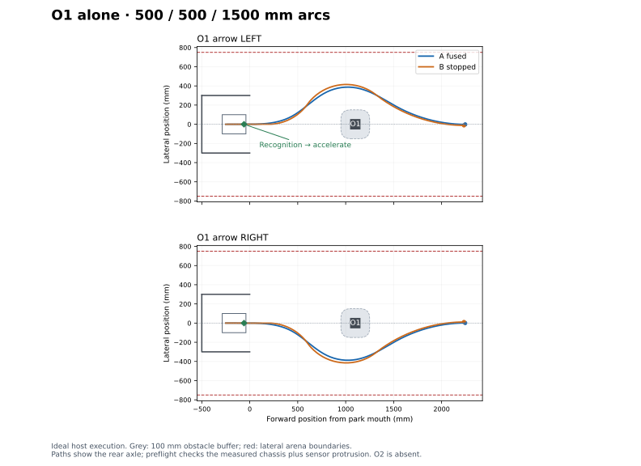

# Isolated O1 bypass: gentle four-primitive A/B

Branch: `experiment/task2-anchored-parameterised`.
The current `TestMain.c` entry runs `MotionSequenceFusionTestRun()` with
`MOTION_SEQUENCE_FUSION_TEST_OBSTACLE1_BYPASS` (selector **5**).
It ends after bypassing O1 and gradually returning to the centre line, facing +x.
O2 is absent from this experiment. Its existing configuration and eight-primitive
route remain available as selector 4; see [the full-route guide](README_task2_anchored.md).
The loose O1 exit extends into the space where O2 could be in the full task;
this isolated route does not establish a valid O2 handoff.

## Important settings

Edit the grouped `obstacle1RouteConfig` initializer in
[`Src/Obstacle1Route.c`](Src/Obstacle1Route.c). Both trials receive frozen
copies and geometric preflight before hardware initialization or either launch.

| Parameter | Default | Meaning |
| --- | ---: | --- |
| `arrow` | `TASK2_ARROW_LEFT` | `LEFT` / `RIGHT` mirrors the entire bypass. |
| `parkToObstacleMm` | 1050 mm | Park mouth to O1 **front face**. Configurable independently of the turn direction. |
| `obstacleBufferMm` | 100 mm | Required nominal separation between O1 and the complete rotated body. |
| `arenaHalfWidthMm` | 750 mm | Lateral arena boundary for this O1-only experiment. |
| `approachSpeedCps` | 2000 CPS | Cruise request before the simulated recognition reply. |
| `cruiseSpeedCps` | 5000 CPS | Upper cruise request after recognition; steering/braking limits still apply. |
| `recognitionCameraRangeMm` | 1000 mm | Instantaneous recognition threshold, measured from the lens to O1 front-face centre. |
| `minimumApproachCameraRangeMm` | 500 mm | Minimum lens-to-face-centre range **at the end of the entry blend**. |
| `recognitionLeadMm` | 5 mm | Planned reply precedes the first steering change. |
| `departureRadiusMm`, `bypassRadiusMm` | 500 / 500 mm | Replaces the opposing 275 mm arcs. |
| `departureAngleDeg` | 55° | Stopped-route departure angle; fused lengths are fitted to the same exit pose. |
| `exitRadiusMm` | 1500 mm | Loose final arc instead of tight centring followed by a straight. |
| `entryBlendMm`, `bypassBlendMm` | 500 / 500 mm | Requested full blend lengths; A allows overlap. |

O1 is 100 × 100 mm. The measured chassis length is 227 mm; width remains the
assumed 200 mm. The body front is 190 mm ahead of the rear axle and the tail is
37 mm behind it. Footprint checks conservatively include the 20 mm ultrasonic
protrusion at full body width. The camera is 80 mm behind the body front,
therefore 110 mm ahead of the rear axle. Horizontal FOV is 60°; target width is
an assumed 100 mm. The rear axle starts at `(-250, 0)` in the 500 × 600 mm park.

The dedicated approach requires room before recognition for the full entry
blend. For example, a 600 mm park-to-face setting is rejected in this mode
because the arrow would already be in recognition range at the start.
Direct-direction/non-approaching routes remain deferred.

## Route and recognition

| Primitive | Left bypass | Right bypass |
| --- | --- | --- |
| Approach | Straight along y=0 | Straight along y=0 |
| Departure | +R500 | −R500 |
| Bypass | −R500 | +R500 |
| Loose exit | +R1500 | −R1500 |

The stopped geometry chooses the final angle so the endpoint has y=0 and yaw=0.
Long blends shift the endpoint; A fits its first two arc lengths and derives
its exit length to reach B's nominal endpoint. This uses the existing geometric
blend planner, without a measured servo-response model. Both complete paths
are preflighted at 1 mm intervals against the rotated body, park walls,
obstacle buffer and lateral boundaries. Invalid geometry aborts both trials.

Recognition is simulated from encoder/gyro pose: the first approach observation inside 1000 mm, with the complete assumed arrow width
inside the FOV, raises the cruise request immediately. Direction is a test
parameter; no live ultrasonic, camera or RPi communication is introduced here.
The event's elapsed time and estimated pose are exported in each result.

The active motion profile starts with the 5000 CPS ceiling and receives a
2000 CPS cruise request. On recognition the request becomes 5000 CPS, preserving
progress, endpoint and yaw state. Acceleration remains bounded. A continues
through the entry blend; B completes its straight and starts the first arc
from rest. Both accelerate after recognition instead of retaining approach
speed through the remaining distance.

## Local feedforward speed allowance

The controller supplies the exact signed piecewise feedforward table and
straight command to the sequence planner. Each blend is split at its actual
calibration knots and zero. The speed allowance uses the local raw-command
slope times the summed active curvature derivatives, with half the configured
480 raw units/s reserved for feedforward and half for feedback. Overlapping
ramps can reinforce or cancel. Deceleration lookahead reaches upcoming local
caps before entering their intervals; a configurable 20 ms reference guard
covers the held update near narrow knots. Gentle portions can accelerate after
the steep centre bridge instead of inheriting its cap for the whole blend.

`junctionSpeedCps` in the frozen plan is now a base ceiling when calibration is
attached. Use sample `localSpeedLimitCps` and `targetSpeedCps` for actual local
limits and acceleration. Scalar slope fallback remains for geometry-only callers.
No calibration points or standalone servo rate are changed by this fix.

A retains the earlier fused tuning: straight P100/I50/H0.5, arc P150/I75/H0.5,
matched reference filtering. B retains standalone P270/I150/H0 and yaw-priority
arc exits. Straight acceleration/deceleration is 3000 mm/s²; arc values are
2000 mm/s². Both use the same frozen feedforward calibration.

## Run and export

Build normally in STM32CubeIDE. Set arrow/distance before preflight, place the
robot centred in the park facing +x, and press SW1 for A. Reset the robot to the
same starting pose before pressing SW1 for B. SW1 during a run cancels it;
a failed/cancelled A does not launch B. Timing includes steering preparation
and final braking, excluding manual reset and button waits.

At `MotionSequenceFusionTestFinished`, use the existing exporter:

```gdb
source exp/gdb_scripts/export_fused_motion.gdb
set $mctrl_fusion_battery_v = 12.0
mctrl-fusion-export o1_run01.txt
```

The export includes the O1 settings, both frozen routes and preflight reports,
recognition events, final encoder/gyro poses, A's prepared plan, B's three arc
exits, calibration and speed/steering samples. Pose estimates carry no physical
uncertainty bound.

## Host validation

```sh
python Tests/Host/test_obstacle1_bypass.py --traces /tmp/o1-traces
python Tests/Host/plot_obstacle1_bypass.py /tmp/o1-traces Tests/obstacle1_bypass.svg
python Tests/Host/test_local_feedforward.py
python Tests/Host/test_task2_anchored.py
python Tests/Host/test_unified_motion.py
python Tests/Host/test_motion_profile_limits.py
python Tests/Host/test_fused_export.py --gdb /path/to/gdb
```

The O1 matrix covers both arrows, park-to-face distances 900/1050/1200 mm,
100/150 mm requested buffers, camera recognition, post-reply acceleration,
clearance, four stopped primitives versus one continuous run, rejected
configurations, cancellation and timeout. Existing full-route regressions
remain separate. The fixture tracks wheel commands and geometric yaw ideally;
it does not model servo lag, slip, recognition latency or ultrasonic errors.

Default host timing: **A 5292 ms**, **B 6810 ms**, saving **1518 ms (22.3%)**.
Nominal minimum body gaps are 201.47 mm / 218.75 mm, and A's entry-blend-end
camera range is 537.47 mm. These results prepare the physical O1 comparison;
they do not establish real-world accuracy or clearance guarantees.


