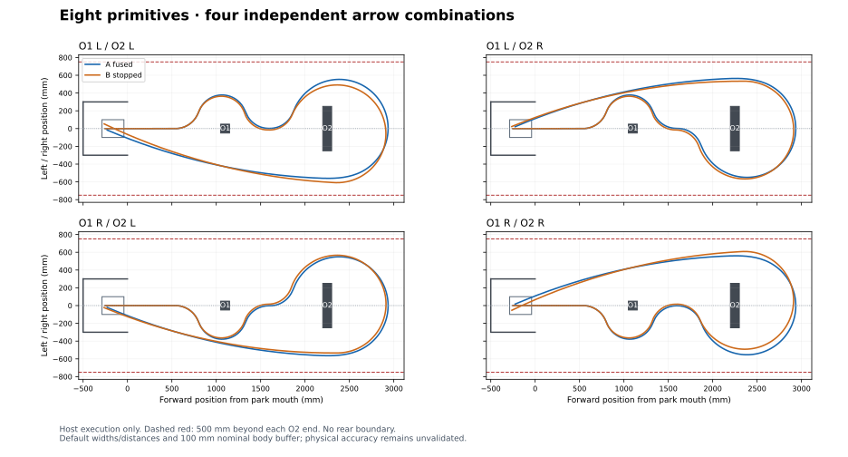

# Parameterised Task 2: anchored eight-primitive A/B test

Branch: `experiment/task2-anchored-parameterised`.
The full route remains available with
`MOTION_SEQUENCE_FUSION_TEST_TASK2_PARAMETERISED` (selector 4).
The current default is the [isolated O1 test](README_obstacle1_bypass.md), selector 5.
Historical selector 0 retains the previous five-primitive experiment.

## Change the important inputs in one place

Edit the grouped `task2RouteConfig` initializer in
[`Tests/Src/Task2Route.c`](Src/Task2Route.c). No primitive lengths need manual editing.

```c
.firstArrow = TASK2_ARROW_LEFT,
.secondArrow = TASK2_ARROW_RIGHT,
.obstacle2WidthMm = 500.0f,
.parkToObstacle1Mm = 1050.0f,
.obstacleFaceGapMm = 1050.0f,
.obstacleBufferMm = 100.0f,
.obstacle2EndSpaceMm = 500.0f,
```

| Setting | Meaning |
| --- | --- |
| `firstArrow`, `secondArrow` | Independent arrow choices; left/right mirror the associated bypass. |
| `obstacle2WidthMm` | O2's full width across the arena. Minimum task width: 300 mm. |
| `parkToObstacle1Mm` | Park mouth to O1's **front face**, along the centre line. Minimum: 600 mm. |
| `obstacleFaceGapMm` | O1's **back face** to O2's **front face**. |
| `obstacleBufferMm` | Minimum planned separation between the assumed robot body and either obstacle. |
| `obstacle2EndSpaceMm` | Available worst-case space beyond **each lateral end** of O2: 500 mm. |

The rear-axle reference starts at `(-250, 0)` inside a 500 mm deep, 600 mm wide
park. Thus the starting axle-to-O1 distance is `parkToObstacle1Mm + 250`;
under the centred 300 mm body assumption, the initial front-body gap is
`parkToObstacle1Mm + 100`. These are different distance references.
O1 is 100 × 100 mm; O2 is 100 mm deep. There is **no boundary behind O2**.
The whole body must stay inside `|y| < obstacle2WidthMm/2 + obstacle2EndSpaceMm`.

Parameters are copied before A starts. Both trials use those frozen inputs;
changing a debugger variable between trials does not change B's geometry.
Stop at `MotionSequenceFusionTestRun` before preflight to change inputs in GDB.

## Route and camera assumption

| Primitive | Purpose |
| --- | --- |
| 1: Approach O1 | Straight on the arena centre line. |
| 2: O1 depart | Turn toward the first arrow. |
| 3: O1 bypass | Opposite arc around O1. |
| 4: O1 centre | Rejoin the centre line at nominal yaw zero. |
| 5: Approach O2 | Centred straight approach. |
| 6: O2 depart | Turn toward the second arrow. |
| 7: O2 back | One large opposite arc around O2's back. |
| 8: Return park | Gentle arc into the park, on the opposite side of O2. |

Recognition and communication are assumed instantaneous upon reaching an
eligible centred view within `recognitionCameraRangeMm` (500 mm).
The simulation already knows the supplied arrows: it verifies that such a
view exists before steering toward either selected bypass. There is no live
camera, ultrasonic endpoint, direction message, or dynamic handoff yet.

`cameraHorizontalFovDeg = 60` and `cameraBehindFrontMm = 80` are explicit inputs.
The lens is 70 mm ahead of the axle **only under the centred 300 mm body
assumption**. Replace body dimensions/frame assumptions with measured values.
`recognitionTargetWidthMm = 100` is an assumed centred arrow width, not a
measurement. Horizontal framing is checked; target height, vertical FOV,
exposure, confidence, and recognition duration are not modelled.

Both whole straight approaches use `approachSpeedCps = 2000` in this first
implementation; arcs request `cruiseSpeedCps = 5000`. Programmed speed zones and
ultrasonic-triggered slowdown are deferred. The short O2 straight provides a
view under the instantaneous-recognition assumption, not a timed capture dwell.

## Geometry controls and rejection

The next group in the initializer exposes camera-to-face ranges at anchored
arc entries, O1 radius/rejoin distance, O2 departure radius/back-radius growth,
and return heading. `secondBackRadius = obstacle2WidthMm/2 + secondBackExtraRadiusMm`.

A fuses all eight primitives. B uses eight established standalone primitives,
with yaw-priority termination at its six arc exits. A retains the previous
Task 2 tuning; B retains the stopped tuning. The new route does not reuse the
old experiment's timing result.

A's full blend ceilings are named parameters:

- Camera entries and the O1 rejoin: `cameraJunctionBlendMm` (10 mm).
- O1 opposite-turn junctions: `firstBypassBlendMm` (100 mm).
- O2 opposite-turn junction: `secondBypassBlendMm` (100 mm).
- Broad return junction: the existing `motionSequenceFusionTestTask2BlendLengthMm`
  request (500 mm).

Zero planner overrides retain historical behaviour. The route settings require
positive ceilings. Stops always disable blending. Overlap remains enabled for
A, but this geometry deliberately uses shorter local blends to preserve the
camera view and clearance. Their slew-limited speeds can make A slower than B;
this is an experiment, not a guaranteed fusion advantage.

The builder derives lengths/radii, compensates the nominal forward displacement
introduced by O1's symmetric blends, and samples the actual production planner
at spacing no greater than 1 mm. It checks the rotated body, obstacle sides,
lateral space, park walls/return footprint, and centred horizontal camera views.
If **either** preflight fails, neither trial starts. The OLED and GDB report a
reason, such as `NO_CENTRED_APPROACH`, `NO_CAMERA_HANDOFF`, or
`CLEARANCE_OR_BOUNDARY`. Input ranges do not imply every combination is feasible;
changing distances or width can require adjusting the exposed geometry controls.

The gentle negative return can lie beyond the standalone API's nearest measured
negative calibration point. This test adds a local **derived** endpoint on the
existing centre-to-nearest-point interpolation line so B can execute that arc.
It does not create a new measurement or change shared calibration. This part
still needs physical validation.

## Run, inspect, and maintain

Reset the robot to the stated park pose before each ready-screen button press.
Timing includes controller preparation and final braking, excluding button waits
and the hand-clearance delay. Cancellation/failure prevents the next trial.

With the target suspended, use the existing export command:

```gdb
source exp/gdb_scripts/export_fused_motion.gdb
set $mctrl_fusion_battery_v = 11.95
mctrl-fusion-export task2_anchored_01.txt
```

The export includes input settings, frozen A/B route steps, preflight margins,
recognition poses, the prepared fused plan and speed caps, stopped arc exits,
logs, timing, and `obstacle1ExitPoseEstimate` for each completed bypass.
The latter integrates encoders and gyro through primitive resets/braking. It
is a diagnostic estimate, **not an absolute position guarantee or covariance**.

Host checks use production C controllers with encoder/gyro stubs and sanitizers:

```sh
python3 Tests/Host/test_task2_anchored.py --traces /tmp/task2-anchored-traces
python3 Tests/Host/test_fused_export.py --gdb /path/to/gdb
```

They cover independent arrows, width/distance variations, nominal buffers,
executed footprint/boundaries, parking, configuration rejection, cancellation,
timeout, blend overrides, and the historical full regression suite. The fixture
stops instantly; the production 75 ms yaw predictor assumes braking coast.
Consequently stopped-run execution can fall inside the nominal obstacle buffer
while remaining collision-free. These tests do not validate tyre/servo dynamics
or establish a physical tracking-error reserve. Field logs must establish that
reserve before treating the configured buffer as a guaranteed physical margin.

Validation covered 64 A/B pairs (128 runs): all four arrow combinations, widths
300/350/400/500 mm, park-to-O1 settings 600/1050 mm, and inter-obstacle face gaps
1050/1100 mm. This is a tested set, not an exhaustive feasible envelope.
With the default L/R inputs, the host returned A = 18.910 s and B = 17.898 s;
these are software timings with local feedforward slope limits. Other route settings and hardware runs may differ.



Regenerate the illustration after collecting default traces:

```sh
python3 Tests/Host/plot_task2_anchored.py /tmp/task2-anchored-traces Tests/task2_anchored_route.svg
```
