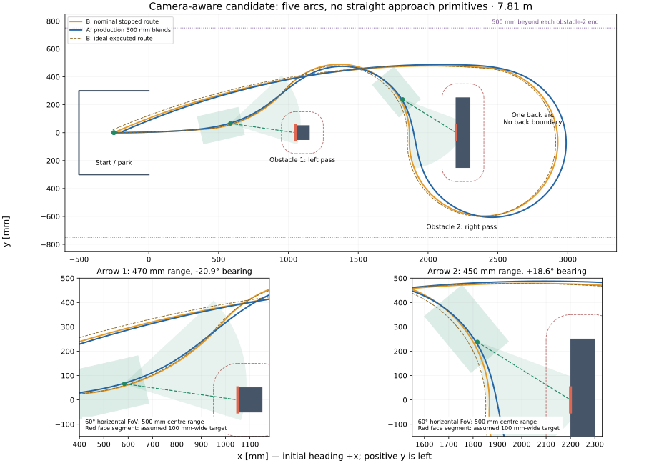

# Task 2 route with camera visibility

Candidate branch: `experiment/task2-camera-route`. The current physical-trial route is preserved on `experiment/task2-overlap-single-arc`; this candidate does not change its firmware defaults.

Five forward arcs provide horizontal views of both front-facing arrows without a straight approach primitive. The required body buffer is 100 mm. This is the fewest-primitives candidate verified in the searched families; a global minimum primitive count is not proven. The route is 7814.15 mm long.

## Geometry and assumptions

Coordinates and the arena match the previous simulation: rear-axle start (-250, 0), heading +x; park x=-500…0, y=±300; obstacle 1 centre (1100, 0), 100×100; obstacle 2 centre (2250, 0), 100×500. Exactly 500 mm of space is assumed beyond each end of obstacle 2, so the whole body stays within y=±750. No boundary behind obstacle 2 is imposed.

The centred 300×200 mm body remains an assumption. With its front 150 mm ahead of the rear-axle midpoint, the camera 80 mm behind the front is 70 mm ahead of that midpoint. The camera points forward; the confirmed 60° is treated as horizontal field of view. Range is measured from the camera to the arrow centre.

The rule PDF (pages 5–6) places arrows at the obstacle midpoint and at the same height as Task 1. It supplies no numerical height or arrow dimensions. Optimisation assumes an 80 mm-wide centred image; dense verification also checks a complete 100 mm-wide target. The first obstacle face is itself only 100 mm wide. The second image width still needs confirmation. Vertical framing and 3D range need camera/arrow height, pitch and vertical FoV.

The optimiser adds a 50° maximum face-incidence angle as an engineering assumption to reject glancing views; it is not a rule or measured recognition limit. Selected poses are about 8° and 30° off the face normal. Lens distortion, resolution, motion blur and inference latency are not modelled.



## Primitive table

Positive radii turn left. Distances are forward arc lengths; request 5000 CPS on each primitive, with the existing gains, filters, motion limits and 500 mm fusion request. All primitives exceed 500 mm naturally; none is lengthened to satisfy a hard minimum. The overlap policy remains enabled on A, but these four 500 mm ramps do not overlap on this particular route.

| Primitive | Distance (mm) | Radius (mm) | Heading change |
| --- | ---: | ---: | ---: |
| 1. Gentle departure left | 666.82 | +8455.28 | +4.52° |
| 2. Left bypass of obstacle 1 | 654.08 | +837.21 | +44.76° |
| 3. Right sweep and arrow-2 view | 1246.71 | -502.22 | -142.23° |
| 4. Single left arc around obstacle 2 | 2493.84 | +531.51 | +268.83° |
| 5. Left return into park | 2752.70 | +5664.87 | +27.84° |

Ready-to-use table for the Task 2 sequence builder:

```c
const MotionSequenceFusionTestStep fusionTestSteps[] = {
    {666.820624f, 8455.275130f, FUSION_SPEED_CPS},
    {654.082464f, 837.209093f, FUSION_SPEED_CPS},
    {1246.706590f, -502.224962f, FUSION_SPEED_CPS},
    {2493.837177f, 531.511412f, FUSION_SPEED_CPS},
    {2752.699782f, 5664.872207f, FUSION_SPEED_CPS},
};
```

## Verification and camera windows

| Geometry | Minimum body clearance (mm) | Boundary margin (mm) | Final rear-axle pose (mm) |
| --- | ---: | ---: | --- |
| A, production fused planner | 119.98 | 26.27 | (-187.56, +8.97) |
| B, nominal arcs | 121.90 | 34.77 | (-250.00, +0.00) |
| B, ideal standalone execution | 118.64 | 31.48 | (-257.58, +20.88) |

Both bodies fit completely in the park; obstacle sides, mouth-wall intersections, side boundaries and standalone yaw-priority exits pass the production C host harness. Nominal final heading is 203.72°. Actual ideal B ends at 203.19°. A is nominal geometry rather than a servo/vehicle plant simulation.

| Strategy / arrow | Selected camera range (mm) | Centre bearing | Whole 100 mm target viewing window (mm) | Ideal execution window (ms) |
| --- | ---: | ---: | ---: | ---: |
| A nominal, arrow 1 | 470 | -20.9° | 59.0 | Not measured |
| A nominal, arrow 2 | 450 | +18.6° | 82.0 | Not measured |
| B ideal execution, arrow 1 | 461 | -19.8° | 72.2 | 114 |
| B ideal execution, arrow 2 | 476 | +21.8° | 40.2 | 61 |

These are full-target horizontal windows, not merely centre visibility. Both face normals point toward the park; the second view is already past obstacle 1 and is not occluded by it. Centre-only windows are longer, but do not guarantee full-arrow framing. A’s viewing durations are not measured by this report.

The second full-target window is only 61 ms on ideal B at the configured speed. These numbers establish eligible image poses, not successful recognition. If exposure/frame delivery needs a longer window, reduce speed locally during that arc; this need not add a motion primitive or an alignment manoeuvre. Inference may finish after image capture, but must finish before the route commits to the selected bypass. The fixed left/right simulation does not verify online decision latency or feasibility of every alternative branch from the capture pose.

Ideal timing is A=14048 ms, B=14950 ms (902 ms / 6.0% savings). These refer to the new route and are not the earlier physical 12.74/14.03 s measurements. This camera route is 428.48 mm longer than the successful 7385.66 mm route. It has not been run on the physical robot.

## Search scope

Three-arc trials did not produce a valid route. Four-arc trials could place a face centre at the range/FoV intersection, but did not yield a finite full-target recognition window. Five arcs are therefore the fewest verified here. This is a local numerical search over specific tangent-circle families; failure to find a four-arc candidate is not proof that every possible four-primitive route is impossible.

150 mm candidates with useful nominal views were found, but failed the joint fused/ideal-execution boundary checks under the same constraints. No 150 mm version is qualified by this report. That is a search result, not a proof that 150 mm is impossible.

Search reserves are 22 mm for nominal B obstacle clearance, 20 mm for A obstacle clearance, 35 mm for B boundaries and 25 mm for A boundaries. The selected near-converged solution has a 0.0025 mm residual in a numerical reserve; dense geometry and the C verifier independently pass the actual 100 mm requirement.

## Reproduce

```sh
python3 Tests/Host/plan_task2_camera_route.py --verify-plan Tests/task2_camera_route_plan.json
python3 Tests/Host/verify_task2_camera_route.py --traces /tmp/task2-camera-traces
python3 Tests/Host/plot_task2_camera_route.py --traces /tmp/task2-camera-traces
```

The verifier substitutes the candidate table and clearance in temporary host test inputs. It retains the production controller/planner, gains, filtering, arc exits, braking and hardware-harness behaviour. It checks complete 100 mm target horizontal visibility independently of the optimiser. The existing on-target source and global defaults are not changed.

To search again (numpy/scipy required):

```sh
python3 Tests/Host/plan_task2_camera_route.py --clearance 100 --attempts 6 --output /tmp/task2-camera-search.json
```

Host checks use ASan/UBSan and strict GCC warnings. No new firmware C implementation is introduced, so this report does not claim a fresh STM32 target build.
