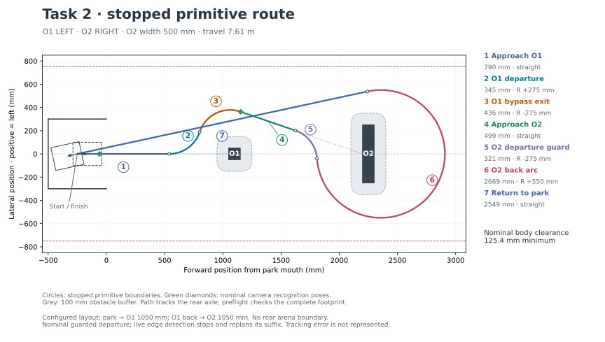

# Standalone Task 2 route test

`TestMain.c` runs `Task2MotionTestRun()` once. Every motion uses the existing
`MotionController_MoveStraight()`, `MotionController_MoveArc()`, or the
caller-terminated `MotionController_MoveStraightContinuous()` and finishes
stationary before the next primitive. Fusion remains abandoned. Arc exits keep
the stopped-run yaw-priority policy and tuning.

## Approach and departure

The O1 departure retains its original R275 sweep. Its second arc now ends at
19 degrees inward: -19 after LEFT, +19 after RIGHT. The O2 approach is a straight
at that heading, initially at approach speed, with a 1000 mm maximum length. Both
approaches raise their soft speed request to cruise after simulated recognition.
The complete
assumed arrow must fit the camera range and field of view. The normal departure
endpoint is 500 mm camera-to-arrow-centre range; the planner tries earlier
endpoints in 25 mm range increments if turning clearance requires it.

Same-arrow departure (LL/RR) uses the forward ultrasonic sensor only. Opposite arrows
use side IR on the straight only: LEFT selects right IR and RIGHT selects left IR.
The preferred R325 departure arc completes to mirrored +/-90 degrees with IR
polling disabled. The continuous straight then begins at that measured stopped
heading, with no distance endpoint.

Three initial ADC readings <=400 confirm that O2 has already ended. The robot
brakes and uses the beam intersection at the straight-start pose as a conservative
width bound; preceding presence is not required in this case. Otherwise three
readings >=700 acquire O2, and three consecutive readings <=400 confirm eventual
disappearance. Readings 401..699 confirm neither state. An unresolved initial
state times out after 1500 ms; cancellation and overall/braking timeouts remain.

The edge estimate and braking event are distinct. During the straight, a three-
sample median rejects isolated spikes. The detector retains the plateau pose
before a sustained decline: default minimum filtered drop 200 ADC counts, three
sustained lower filtered observations (equal values count) and 20 mm travel. Upward excursions >50 counts
cancel a candidate; a stable new plateau can replace an unconfirmed one. Final
absence confirms the event, but width is calculated from the retained onset
pose. If there is no usable trend candidate, the first absent pose remains an
explicit threshold fallback. These are provisional signal parameters for physical
validation; ADC is used for presence/trend, not converted to a range.

After braking, the route has three separately planned stopped stages:

1. R275 quarter-turn opposite to departure, ending parallel at heading zero.
2. Rear bypass from the measured quarter-turn stop. Its radius follows from
   obstacle clearance and available arena side space. Prefer a tangent rear arc
   aimed through the carpark's body-centre target, so one straight can finish the
   return. Entry collisions get a bounded positioning-straight refinement. The
   predicted tangent straight must clear O1, O2 and the buffered carpark. If it
   cannot, retain the parallel rear-arc/alignment fallback.
3. From the measured rear-arc stop, recheck the straight with that actual heading.
   Its length places the whole body's centre closest to (-250, 0), accounting for
   the rear axle's offset. If the straight cannot fit, use the existing four-choice
   parking join with unequal alignment angles. A direct return can park diagonally;
   full-body containment and wall buffers, rather than exact 180-degree yaw, decide
   acceptance. `obstacle2TangentRearArc` and `obstacle2StraightParkReturn` identify
   these choices in the export.

The R275 turn, positioning straight and rear arc retain the agreed reduced
obstacle-buffer exception. Body overlap and side-boundary violations are still
rejected. Straight return and parking keep the normal 100 mm obstacle buffer,
35 mm arena side margin. Carpark walls have separate margins: **100 mm for
both side walls and their entrance tips**, and **75 mm for the back wall**.
Distances to the finite wall segments are checked even while the chassis is
outside the park mouth, so corner approaches cannot evade the side buffer. The larger of nominal
and observed width is checked, with the original arena side boundaries retained.

The fixed O1 template is validated offline, with no online sweep. Variable O2
primitives use bounded interval certificates and reuse accepted clearance results.
Every planning call has a 12,288 footprint-check budget. Prefix straight distances
are nominal geometry previews, not IR execution limits. `sensorTerminated=true`
tells `LaunchStep()` to use continuous motion; measured lengths replace previews
when the robot stops. Full +/-90-degree departure and a bounded initial-absence
estimate must fit the configured approach and camera limits; some narrow, long-gap
layouts that formerly stopped inside the arc are now rejected at setup.

Exports include `routeSetupMs`, `returnSetupMs` (R275), `parallelReturnSetupMs`
(rear bypass), and `parkingReturnSetupMs`, plus the measured stops at each stage.
Pending flags identify the stage: `obstacle2ReturnPending`,
`obstacle2ParallelReturnPending`, and `obstacle2ParkReturnPending`.

The initial rear-axle coordinate remains -250 mm. The finish target instead
centres the entire collision footprint, including its front protrusion. At a
180-degree heading, the rear axle finishes at -163.5 mm, with 126.5 mm nominal
back-wall clearance and 200 mm side clearance. The tangent straight accounts for
its diagonal heading when targeting the body centre. Stopping and sensor/control
errors still require physical verification.

## Configuration

Edit `task2RouteConfig` in `Src/Task2Route.c` for both arrows, the reference O2
width, O1 distance, the valid 600–1500 mm face gap, available end space (default
500 mm per side), speeds, camera geometry, clearances and approach/departure
parameters. The original virtual O1 rejoin anchor only determines its retained
sweep angle; the robot no longer completes that rejoin before O2.

Edit **`task2ObstacleSensorConfig` in `Src/Task2MotionTest.c`** for mounts:

| Sensor | Ahead of rear axle | Left of rear axle | Beam yaw relative to chassis |
|---|---:|---:|---:|
| Ultrasonic | 210 mm, measured | 0 mm | 0 degrees |
| Left IR | 155 mm, measured | +37.5 mm, measured | +90 degrees |
| Right IR | 135 mm, measured | -33.5 mm, measured | -90 degrees |

The lateral IR offsets use the measured 189 mm width between the outer sides of
the front wheels: left inset 57 mm gives `189/2 - 57 = 37.5`, and right inset
61 mm gives `-(189/2 - 61) = -33.5`. This reference does not change the 200 mm
collision footprint.

The same ultrasonic mount is used for startup ranging and moving measurements.
`task2MotionTestConfig` controls startup ranging, control/log periods and
run/brake timeouts. All sensor configuration is frozen at run start and exported.

Ultrasonic and side IR are enabled by default. Mount coordinates remain
configurable. `aheadMm` is measured parallel to the chassis centreline from the
rear-axle midpoint to the receiver-lens centre; `leftMm` is the separate lateral
offset. Opposite-arrow IR acquisition is not restricted to the nominal O2 width.
IR never acquires during approach or the opposite-arrow departure arc. The legacy 80-degree gate is no longer used for LL/RR because they use USS only.

Every fresh selected IR conversion is logged with `irFresh=true`. The trace
includes raw ADC, `irFilteredAdc`, `irPeakAdc`, `irDeclineSamples`,
`irTrendCandidateValid` and `edgeMethod`. The final detector state includes the
onset, first-absence and straight-start poses. Edge methods distinguish threshold
fallback, trend onset and an initial-absence width bound. Regular motion entries
retain the latest reading with `irFresh=false`; ADC faults stop the run.

### LL/RR ultrasonic departure

O2 acquisition uses an **11-sample median** and three present confirmations.
During departure the window switches to **5 samples**, seeded from the acquired
baseline. Each raw range is compensated using its measurement-trigger pose and
the expected shortest ray to the configured O2 plane. Filtering these residuals
avoids treating the normal approach/turn range change as an obstacle edge.
The median rejects isolated 2000+ mm readings; the shorter departure window
limits delay while turning. Acquisition can finish while stationary at the
approach endpoint, subject to the existing 1500 ms timeout.

A sustained upward residual jump of **250 mm**, confirmed by three filtered
observations, brakes the robot. The width estimate uses the **first raw jump
pose in the confirmed run**, before the median/confirmation delay. Separately,
three consecutive completed **no-echo timeouts** confirm disappearance; their
first trigger pose is used for the estimate. No-echo is never inserted as a
fabricated long range in the median. A returning echo resets no-echo confirmation;
ADC/trigger faults remain errors. Neither event can fire before USS acquisition.
Side IR is disabled for LL/RR, and USS cannot terminate LR/RL departure.

The inward edge of the configurable USS cone intersects the O2 plane to give a
width bound, including 20 mm edge uncertainty on each side. The default is a
**7.5-degree half-angle** (15-degree full cone), 80 mm range-association tolerance,
and 60 ms fresh-sample period. These are provisional physical assumptions.
The LL/RR detector refuses to infer an edge after **45 degrees** from the face
normal; reaching this limit or the preflighted finite departure endpoint without
confirmation stops the run. The nominal departure endpoint remains a safety
limit for a stuck USS, rather than evidence of disappearance.

After the measured USS brake stop, the existing geometric return planner checks
a complete nominal tail. It executes through the rear bypass, then replans
parking from that measured stop, preferring a straight. A single corrective
parking arc centres the whole body's footprint when a straight cannot fit.
If the rear exit points outward, a buffered R275 heading correction may precede
parking; its remainder is replanned at the measured correction stop, with at most
two such corrections. Existing alignment/traverse fallbacks remain. The nominal
LL/RR return reserves an additional 20 mm of arena side clearance for stop-pose
error. All parking checks retain the 100 mm side/tip and 75 mm back buffers.

Exports include every fresh LL/RR USS observation (`ultrasonicFresh`), validity,
raw range, filtered/baseline residuals, independent jump/no-echo counters, the
onset pose, and `TASK2_EDGE_USS_RANGE_JUMP` or `TASK2_EDGE_USS_NO_ECHO`.
`parkingHeadingCorrections` reports the additional stopped corrections.

O2 width and face gap still describe the **test reference layout**, used for
preflight and echo association. Sensor events control departure termination and
infer a width bound; this is not yet a production planner for an unknown O2
position. Configured arrows and camera visibility simulate recognition; no live
camera/RPi command is connected. Startup ultrasonic remains one fresh O1 reading.

## Running and exporting

Press SW1 at the measurement screen, then at the ready screen to start. A failed
startup reading or preflight aborts before motor initialization. Disable
`measureObstacle1AtStartup` to use the configured O1 distance. The default startup
geometry gives `parkToObstacle1Mm = ultrasonicRangeMm - 40`.

O1 and O2 recognition raise their straight's soft speed request from approach to
cruise speed without restarting the primitive or changing its endpoint. Normal
profile deceleration still stops the approach before the separate departure.
Both recognition times/poses, acquired sensors,
confirmed edge, observed width and stopped departure pose are recorded.

Break at `Task2MotionTestFinished`, then export while suspended:

```gdb
source exp/gdb_scripts/export_task2_motion.gdb
set $task2_battery_v = 12.0
task2-motion-export task2_run01.txt
```

The export includes frozen mounts/thresholds, detector state, route/step count,
startup range, controller tuning, per-step exits, stopped/final pose estimates,
and speed/steering samples with ultrasonic acquisition/loss state. Use a fresh
filename.

Host checks:

```sh
python Tests/Host/test_task2_motion.py
python Tests/Host/test_unified_motion.py
python Tests/Host/test_motion_profile_limits.py
python Tests/Host/test_task2_export.py --gdb /path/to/gdb
```

The host fixture models wheel/gyro tracking, an ideal ultrasonic cone and IR
face intersections. It
checks 128 layouts (both O1 positions, all arrows, four gaps and four widths),
edge acquisition/confirmation, mounted sensor geometry, median-filtered USS jumps, IR hysteresis, stopping,
cancellation, absent/stuck/faulted sensors and exports in both planner modes.
Both modes check all 128 reference layouts: 122 complete and six narrow, 1500 mm-gap cases
reject before motors initialize under the full-90-degree policy. The 64 additional LL/RR cases at published speeds all complete with injected
long-range outliers and isolated no-echo samples, covering both background-jump
and no-echo departure. Missing acquisition and stuck USS terminate without a
false edge. All eight faster
mirrored opposite-arrow cases at 7000/3000/2000 CPS and current published tuning complete. Tests
also replay run08 ADC (about 507 mm from onset versus the former 751 mm estimate),
its original 751 mm return bound and mirror, run10's abrupt drop settling at an
unchanged median (about 554 mm from onset versus its former 651 mm fallback),
noise/rebounds, initial absence, and
an actual 300 mm obstacle while the planner still assumes 500 mm. Recorded
run09/run10 quarter-turn poses and their mirrors use one parking straight after
the rear arc, with the entire simulated robot inside: minimum wall gaps in the
controller fixture exceed 110 mm at the sides/tips and 102 mm at the back.
Explicit checks reject the old rear-axle finish target and close approaches to
an entrance tip even when the whole chassis is still outside the park.
The run03 recorded stop with a 647 mm width bound and its mirror execute through
the real stopped controller fixture, verifying the measured quarter-turn stop,
direct back arc, obstacle crossings, full-body clearance and parking.
It does not model real
acoustic reflections, servo lag, wheel slip or camera latency.

## Route graph



For opposite arrows this shows the nominal preview through the IR straight;
the remaining stages are created after their measured stops. Same-arrow plots show the full
nominal guarded route. An executed route can have more primitives. Regenerate
from the actual C planner (host compiler, NumPy and Matplotlib required):

```sh
python Tests/Host/plot_task2_motion.py
```

Overrides: `--first-arrow`, `--second-arrow`, `--park-to-o1`, `--gap`, `--width`
and `--output`. Each plotted route passes the same preflight. The path references
the rear axle; body checks include the measured chassis (-37 to +190 mm) and the
20 mm ultrasonic protrusion conservatively at full 200 mm width. Camera offset
is +110 mm. Startup pose remains rear axle x=-250; place the visible chassis tail
213 mm from the park back wall.

## Production interface requirement

Keep sensor evidence, geometry estimation, and route planning separate when this
experiment moves into production. IR/USS and a future camera should provide
observations to an estimator; the planner should consume O2 width and O1–O2 gap
estimates with validity, uncertainty, and measured-versus-bound semantics.
Nominal defaults and collision buffers must remain separate from estimates.
Motion launch must not infer width/gap or choose which sensor supplies them.
The experimental detector still projects an edge against the configured O2 plane;
live gap estimation, camera assistance and adaptive approach shortening are
separate pending changes, not implemented by this LL/RR update.
